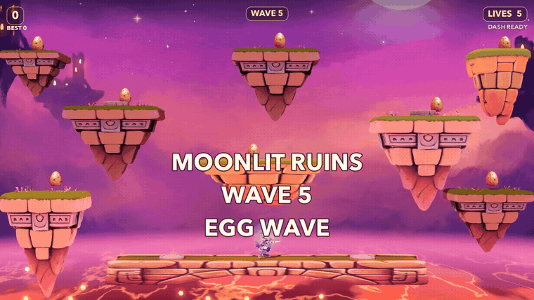
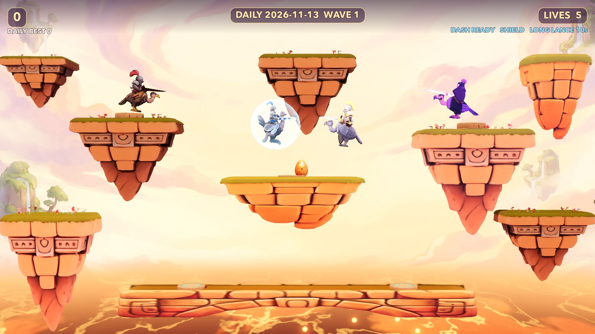
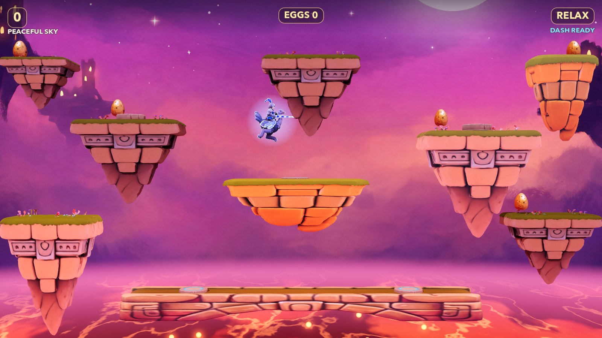
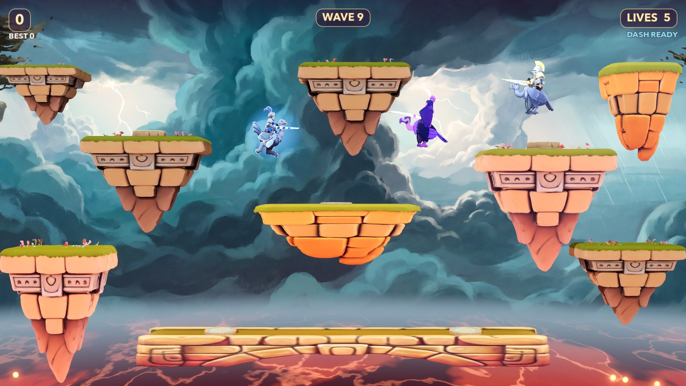
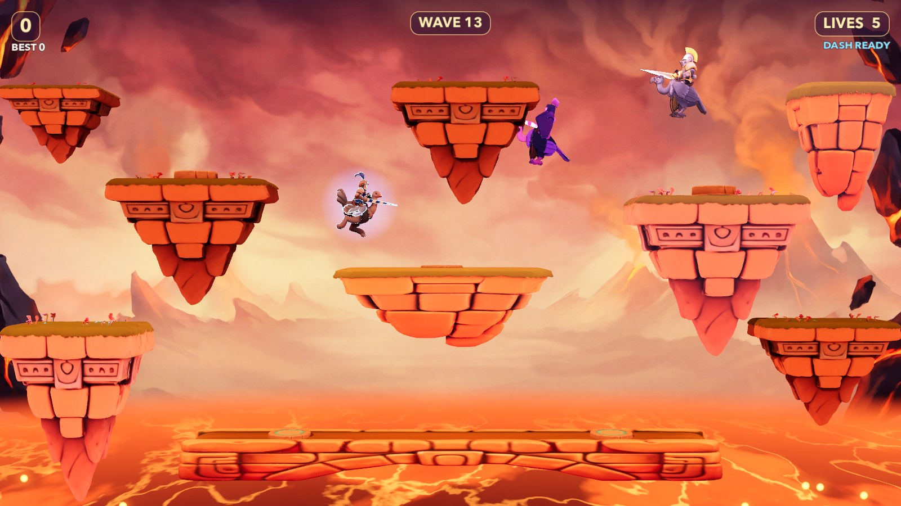
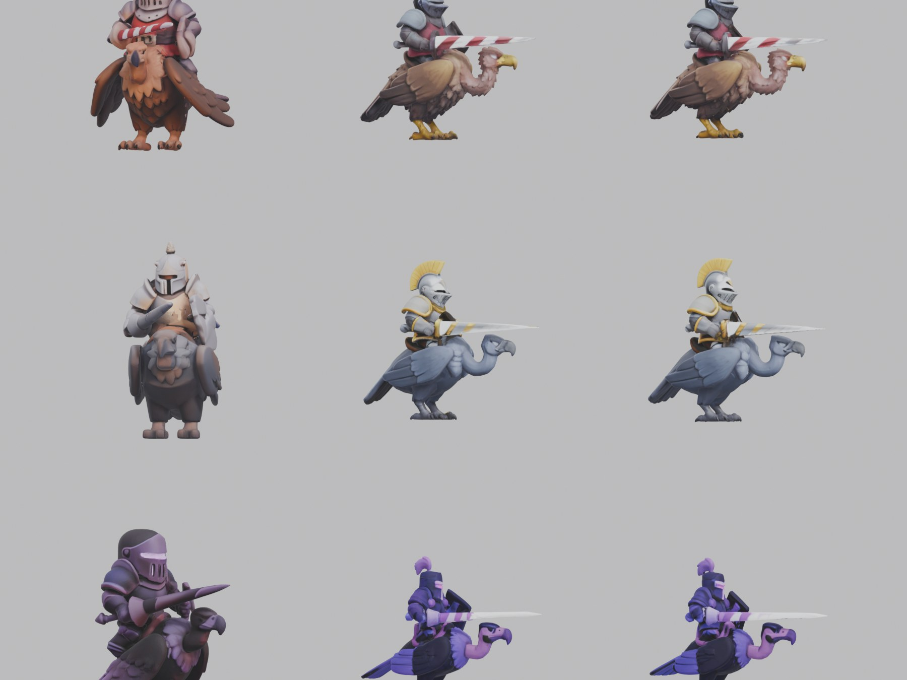

# Skyjoust

[](https://charles-forsyth.github.io/skyjoust/)
[](https://github.com/charles-forsyth/skyjoust/actions/workflows/ci.yml)
[](https://godotengine.org/)
[](LICENSE)

An open-source 2.5D single-screen aerial jousting game built in **Godot 4.7 Forward+**, combining deterministic 60 Hz 2D arcade physics with hand-painted 3D miniatures, two-segment hinged feathered wings, custom volcanic shaders, and zero-sample FFmpeg-synthesized sound effects.

> **Interactive 3D Models & Audio Demo:** Open **[charles-forsyth.github.io/skyjoust](https://charles-forsyth.github.io/skyjoust/)** to **rotate and zoom all 10 3D `.glb` models in WebGL**, audition the synthesized arcade SFX soundboard, and flip through all four sky-island arenas in your browser.
>
> *Independent open-source tribute inspired by Williams Electronics' 1982 arcade classic Joust. Not affiliated with or endorsed by Williams Electronics or Warner Bros. Entertainment.*

<p align="center">
  <a href="https://charles-forsyth.github.io/skyjoust/">
    
  </a>
</p>

---

## Screenshots & 3D Miniature Craft

| Sunset Isles — Daily Challenge & Active Perks | Moonlit Ruins — Peaceful Flight Mode |
| :---: | :---: |
|  |  |

| Storm Crags — Crumbling Wrap Ledges | Ember Peaks — High-Velocity Shadowlords |
| :---: | :---: |
|  |  |

### Solving Side-View Jousting Silhouettes (Octree-384 vs. Octree-512)

Because jousting collisions are decided by exact lance-tip elevation (`lance_y = pos.y + 1.35`), foreshortened lances break visual readability. Re-generating the enemy knights from strict right-facing side-profile concepts with clean negative space above the vulture's head at **octree 512 / 80,000 faces** raised turntable quality from `3.0–4.5/10` (left column) to **`9.0–9.5/10`** (center & right columns) — **[inspect every `.glb` in 3D on the showcase page](https://charles-forsyth.github.io/skyjoust/#hangar)**:



---

## Highlights

- **Deterministic 2.5D Physics Plane (`game/rider.gd`, `game/main.gd`):** All movement, toroidal screen-wrap (`x in [-15, 15)`), lance height checks, and ledge collisions run in pure 60 Hz 2D math with isolated gameplay (`rng`) and visual (`vis_rng`) random streams — allowing 20 minutes of gameplay (`--sim=1200`) to be verified headlessly in ~4 seconds.
- **Hinged Two-Segment Feathered Wings (`tools/build_wing_mesh.py`):** Custom Blender BMesh wing rig (`WingRight`/`WingLeft` + `WristRight`/`WristLeft`) with outward-facing normals for inverted-hull outlines. Wings fold away while running on ledges, sweep on flaps, extend rigid on downstroke, and flex inward on recovery.
- **Air-Dash Lunge & Impact Juice:** `SHIFT` / `J` / Gamepad `X` triggers a `0.18 s` horizontal lunge (`2.2 s` cooldown) with a `+0.20` lance tie-break advantage, paired with hit-stop frames, feather bursts, fleeing unmounted buzzards, and `0.22 s` wave-final / pterodactyl slow-motion.
- **Three Playable Modes:**
  - **Classic Arcade (`SPACE` / `ENTER`):** 5 lives, extra life every 20,000 pts, escalating Bounder / Hunter / Shadowlord waves, Egg Waves every 5th wave, and `+3,000` deathless wave survival bonuses.
  - **Daily Challenge (`C`):** Seeded deterministically from today's `YYYY-MM-DD` date so every run that day faces identical spawns and power-up drops, with its own saved daily best.
  - **Peaceful Flight (`F`):** Zero enemies or hazards; molten lava gently updrafts you upward on warm golden sparks while you gather eggs across all four sky-island themes.
- **Escalating Volcanic Hazards & Pickups:**
  - **Wave 3+ Lava Troll Hand:** Basalt hand (`shaders/magma_rock.gdshader`) reaches out of the magma for low-skimming riders near the outer edges; mash flap to break its grip.
  - **Wave 6+ Crumbling Ledges:** Outer wrap islands vibrate and collapse after `1.3 s` of standing weight, regrowing `7.0 s` later.
  - **40s Pterodactyl Hunter:** Immune to body hits — only a head-on lance straight into its open beak slays it (`+1,000` pts).
  - **Power-Ups:** **Shield** (fresnel energy bubble absorbing one losing joust) and **Long Lance** (`12 s` forward energy spearhead + extended reach).
- **Zero-Sample Procedural Audio (`tools/make_sfx.sh`):** All 11 arcade sound effects + seamless 20 s crossfaded volcanic rumble are synthesized deterministically with `ffmpeg -f lavfi` expressions; optional fantasy music loop (`M`, off by default).

---

## Quick Start

Requires **[Godot Engine 4.7+](https://godotengine.org/)** (`Forward+` renderer). All textured `.glb` models, shaders, backdrops, and synthesized `.mp3` clips are included in `game/assets/`.

```bash
git clone https://github.com/charles-forsyth/skyjoust.git
cd skyjoust

# Play directly
godot --path game

# Optional on macOS: build & launch ~/Games/Skyjoust/Skyjoust.app
./tools/build_mac_app.sh
open ~/Games/Skyjoust/Skyjoust.app
```

---

## Controls

| Action | Keyboard | Gamepad |
| :--- | :--- | :--- |
| **Run & Air Steer** | `A` / `D` or `Left` / `Right` | Left Stick / D-Pad |
| **Wing Flap** | `SPACE`, `W`, or `Up` | South Button (`A` / Cross) |
| **Air-Dash Lunge** | `SHIFT` or `J` | West Button (`X`) or `RB` |
| **Start Mode (Title / Game Over)** | `SPACE` Classic · `C` Daily · `F` Peaceful | `A` (Classic) |
| **Help & Rules Overlay** | `H` or `F1` | — |
| **Pause / Quit to Title** | `ESC` or `P` (`Q` while paused returns to Title) | — |
| **Music Toggle / Master Mute** | `M` (off by default, saved) / `N` | — |

---

## Automated Verification Suite

All 30 automated checks across 3 headless scripts run with **zero warnings and zero leaked resources**:

```bash
# 28-check regression suite (physics, wrap math, shield, ptero beak, hand, crumble, wings, dash, modes, UI)
godot --headless --path game -s res://tests/test_all.gd

# Focused hazard suites
godot --headless --path game -s res://tests/tests_hand.gd
godot --headless --path game -s res://tests/tests_crumble.gd

# 20-minute headless 60 Hz endurance playtest (~4 seconds wall time)
godot --headless --path game -- --sim=1200
```

---

## Documentation & Repository Layout

- **[Live 3D Showcase & SFX Board](https://charles-forsyth.github.io/skyjoust/)** — WebGL `<model-viewer>` hangar, arena switcher, and live FFmpeg soundboard (`docs/`).
- **[SPEC.md](SPEC.md)** — Complete technical & mathematical specification (exact constants, platform `Rect2` table, lance differential equation, 3D poly/QA inventory, shader math, and save schema).
- **[ART_BIBLE.md](ART_BIBLE.md)** — Look B palette, player-vs-enemy silhouette contrast rules, and image-to-3D prompt conventions.

```text
skyjoust/
├── game/                   Godot 4.7 Forward+ project (main.gd, rider.gd, egg.gd, sfx.gd, model_fit.gd)
│   ├── assets/models/      Textured Hunyuan3D-2 GLBs + Blender wing_feathered.glb + SCORES.json
│   ├── assets/art/         4 painted sky-island arena backdrops
│   ├── assets/sfx/         Deterministic FFmpeg-synthesized arcade SFX + lava ambience
│   ├── shaders/            lava.gdshader, outline.gdshader, magma_rock.gdshader, shield.gdshader
│   └── tests/              Headless regression & capture scripts (test_all.gd, tests_hand.gd, ...)
├── docs/                   GitHub Pages interactive 3D showcase & soundboard
├── tools/                  build_wing_mesh.py, prep_web_models.py, make_sfx.sh, build_mac_app.sh, sides.py
├── concepts/               2D studio concept art (Batch 1 props + Batch 2 side-profile knights)
└── cluster/                Slurm batch scripts for offline Hunyuan3D-2 mesh/texture generation
```

## License

Released under the [MIT License](LICENSE).
